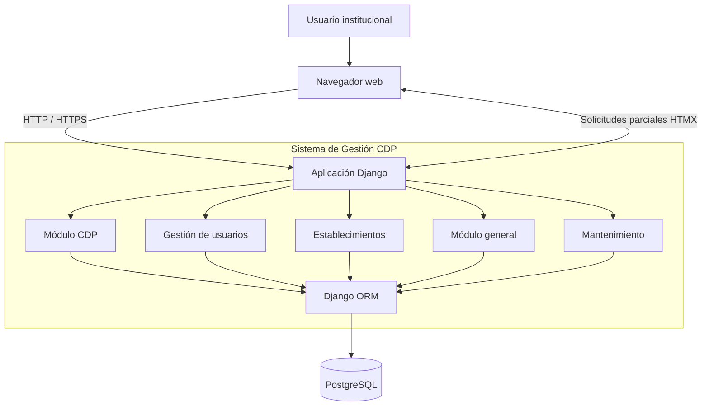

# Sistema de Gestión de Certificados de Disponibilidad Presupuestaria (CDP)

**SLEP Puerto Cordillera | Django | PostgreSQL | HTMX | AWS**

Sistema web desarrollado para el **Servicio Local de Educación Pública (SLEP) Puerto Cordillera**, orientado a la digitalización, centralización y gestión de los Certificados de Disponibilidad Presupuestaria (CDP), facilitando el control, seguimiento y trazabilidad de los recursos presupuestarios de la institución.

El proyecto fue desarrollado durante mi práctica profesional, con el propósito de optimizar procesos administrativos relacionados con la gestión presupuestaria, reducir la dependencia de registros manuales y mejorar el acceso a la información.

La solución integra gestión de certificados, administración de usuarios, establecimientos educacionales, clasificación presupuestaria y consultas de información mediante una plataforma web centralizada.

## Tecnologías utilizadas

| Categoría | Tecnologías |
|---|---|
| Backend | Python, Django |
| Frontend | HTML5, CSS3, JavaScript |
| Interactividad | HTMX |
| Base de datos | PostgreSQL |
| Infraestructura | Amazon Web Services (AWS EC2) |
| Gestión de dominio | NIC Chile, DNS |
| Arquitectura | Aplicación web basada en Django |
| Control de versiones | Git, GitHub |

## Objetivo del proyecto

El sistema surge de la necesidad de mejorar la administración de los Certificados de Disponibilidad Presupuestaria utilizados en los procesos de gestión financiera de la institución.

La gestión de estos documentos requiere mantener información consistente sobre los recursos disponibles, los establecimientos asociados, las clasificaciones presupuestarias y los antecedentes de cada solicitud.

La solución busca:

- Centralizar la información relacionada con los CDP.
- Digitalizar procesos de registro y consulta.
- Mejorar la trazabilidad de los certificados.
- Facilitar la identificación de recursos presupuestarios.
- Organizar la información por establecimientos y unidades.
- Proporcionar herramientas de consulta y seguimiento.
- Reducir tareas administrativas repetitivas.
- Facilitar el acceso a información presupuestaria estructurada.

## Arquitectura del sistema

El proyecto implementa una arquitectura web basada en **Django**, utilizando una organización modular para separar las distintas responsabilidades del sistema.

La aplicación procesa las solicitudes del usuario, ejecuta la lógica de negocio y administra la persistencia de información mediante PostgreSQL.

La interfaz utiliza HTML, CSS y JavaScript, incorporando HTMX para realizar solicitudes asíncronas y actualizar secciones específicas sin recargar completamente las páginas.

### Diagrama de arquitectura



La separación por aplicaciones permite organizar las funcionalidades de acuerdo con sus responsabilidades, facilitando el mantenimiento y la evolución del sistema.

## Módulos principales

### 1. Gestión de Certificados de Disponibilidad Presupuestaria

El módulo `cdp` constituye el componente principal de la plataforma.

Permite administrar información relacionada con los certificados y sus respectivas clasificaciones presupuestarias.

**Funcionalidades principales:**

- Registro de información asociada a CDP.
- Consulta de certificados existentes.
- Asociación de certificados con ítems presupuestarios.
- Organización de información por programas, fondos y cuentas.
- Consulta del historial de certificados.
- Seguimiento de antecedentes presupuestarios.
- Relación entre certificados y registros de ejecución presupuestaria.

### 2. Gestión de usuarios

El módulo `usuario` administra la información de los usuarios y sus relaciones con la estructura organizacional.

**Funcionalidades principales:**

- Administración de usuarios.
- Gestión de roles.
- Asignación de privilegios.
- Asociación de usuarios con unidades organizacionales.
- Control de acceso según las responsabilidades de cada usuario.

Este módulo permite estructurar el acceso a las funcionalidades del sistema según el perfil institucional correspondiente.

### 3. Gestión de establecimientos educacionales

El módulo `establecimiento` permite administrar información relacionada con los establecimientos educacionales asociados al servicio local.

**Funcionalidades principales:**

- Registro y consulta de establecimientos.
- Organización de información institucional.
- Asociación de establecimientos con procesos presupuestarios.
- Integración con otros módulos de la plataforma.

### 4. Gestión presupuestaria

El sistema incorpora modelos y relaciones para representar las clasificaciones presupuestarias utilizadas en la administración de recursos.

Entre las entidades trabajadas se encuentran:

| Entidad | Responsabilidad |
|---|---|
| `Cdp` | Representación de certificados de disponibilidad presupuestaria |
| `Item` | Gestión de ítems |
| `Subtitulo` | Clasificación de subtítulos |
| `ItemPresupuestario` | Organización de ítems presupuestarios |
| `SubtituloPresupuestario` | Organización de subtítulos presupuestarios |
| `EjecucionPresupuestaria` | Registro de información de ejecución presupuestaria |

Estas entidades permiten estructurar los datos y establecer relaciones entre los distintos componentes de la gestión presupuestaria.

### 5. Módulos generales y de mantenimiento

La aplicación también incorpora módulos complementarios destinados a organizar funcionalidades compartidas y tareas administrativas.

- `general`: funcionalidades y componentes generales del sistema.
- `mantenimiento`: funcionalidades relacionadas con la administración y mantenimiento de información.

## Estructura del proyecto

La solución utiliza la estructura modular de aplicaciones de Django.

```text
proyecto-master/
│
├── cdp/
│   ├── models.py
│   ├── views.py
│   ├── urls.py
│   └── migrations/
│
├── usuario/
│   ├── models.py
│   ├── views.py
│   └── migrations/
│
├── establecimiento/
│   ├── models.py
│   ├── views.py
│   └── migrations/
│
├── general/
│
├── mantenimiento/
│
└── manage.py
```

Esta organización permite separar la lógica de negocio por dominio funcional y aprovechar los mecanismos de Django para el manejo de modelos, vistas, rutas y migraciones.

## Interactividad con HTMX

Una de las tecnologías utilizadas fue **HTMX**, que permite incorporar interactividad mediante solicitudes HTTP realizadas directamente desde elementos HTML.

Su integración con Django facilita la actualización parcial de componentes de la interfaz sin necesidad de implementar una aplicación frontend completamente desacoplada.

### Aplicación en el proyecto

HTMX se utilizó para implementar consultas dinámicas de información, especialmente en funcionalidades relacionadas con el historial de CDP.

El sistema permite solicitar información asociada a un ítem presupuestario y presentar los resultados dentro de la misma vista.

**Beneficios de su utilización:**

- Actualización parcial de contenido.
- Menor cantidad de código JavaScript.
- Integración directa con vistas y plantillas de Django.
- Reducción de recargas completas de página.
- Mayor fluidez en las consultas de información.

## Persistencia de datos con PostgreSQL

El sistema utiliza PostgreSQL como motor de base de datos relacional.

La persistencia se administra mediante el ORM de Django, que permite definir modelos, relaciones y consultas utilizando Python.

### Características

- Modelado de entidades presupuestarias.
- Relaciones entre usuarios, roles y unidades organizacionales.
- Asociación de establecimientos con información administrativa.
- Gestión de migraciones mediante Django.
- Consultas relacionales sobre registros presupuestarios.
- Uso de identificadores UUID en entidades que requieren identificación única.

La estructura relacional facilita mantener la consistencia entre certificados, clasificaciones presupuestarias y registros institucionales.

## Infraestructura y despliegue

El proyecto contempló el despliegue de la aplicación en infraestructura de **Amazon Web Services (AWS)**, utilizando instancias EC2 para el alojamiento del sistema.

También se trabajó en la configuración de dominio y resolución DNS para facilitar el acceso a la plataforma mediante una dirección web institucional.

### Componentes de infraestructura

| Componente | Tecnología |
|---|---|
| Servidor de aplicación | AWS EC2 |
| Framework web | Django |
| Motor de base de datos | PostgreSQL |
| Gestión de dominio | NIC Chile |
| Resolución de dominio | DNS |

El trabajo de infraestructura permitió abordar aspectos relacionados con la configuración del entorno de ejecución, conectividad y publicación de aplicaciones web.

## Desarrollo y responsabilidades

El proyecto fue desarrollado durante mi práctica profesional en el **Servicio Local de Educación Pública Puerto Cordillera**, abordando necesidades reales de gestión administrativa y presupuestaria.

Mi participación incluyó actividades de análisis, desarrollo, integración y configuración de infraestructura.

### Análisis de requerimientos

- Comprensión de los procesos administrativos asociados a los CDP.
- Identificación de necesidades de registro y consulta.
- Análisis de entidades y relaciones presupuestarias.
- Traducción de requerimientos institucionales a funcionalidades de software.

### Desarrollo backend

- Implementación de funcionalidades utilizando Django.
- Desarrollo de vistas y lógica de negocio.
- Diseño e integración de modelos de datos.
- Implementación de consultas mediante el ORM.
- Gestión de migraciones de base de datos.

### Desarrollo frontend

- Implementación de interfaces con HTML, CSS y JavaScript.
- Integración de plantillas Django.
- Desarrollo de interacciones dinámicas con HTMX.
- Presentación de información presupuestaria mediante vistas web.

### Bases de datos

- Configuración e integración de PostgreSQL.
- Modelado de relaciones entre entidades.
- Administración de migraciones.
- Resolución de problemas de integridad y relaciones de datos.

### Infraestructura

- Configuración del entorno de aplicación en AWS EC2.
- Trabajo con configuración de dominio y DNS.
- Integración de los componentes necesarios para el funcionamiento de la plataforma.

## Desafíos técnicos

### Modelado de información presupuestaria

Uno de los principales desafíos fue representar digitalmente la estructura presupuestaria utilizada por la institución.

Fue necesario comprender las relaciones entre certificados, subtítulos, ítems, establecimientos y registros de ejecución para construir modelos de datos consistentes.

### Gestión de relaciones entre usuarios y unidades

La implementación de usuarios, roles y unidades organizacionales requirió trabajar con relaciones entre modelos Django.

Durante el desarrollo se abordaron problemas asociados a migraciones y dependencias entre entidades como `UsuarioEntidad`, `Rol` y `AreaUnidad`.

### Consultas dinámicas de certificados

La consulta del historial de CDP requirió integrar las vistas Django con HTMX, permitiendo recuperar información mediante identificadores y actualizar secciones de la interfaz.

### Integración con infraestructura AWS

La configuración de la aplicación en AWS permitió abordar desafíos asociados al entorno de ejecución, conectividad y publicación de servicios web.

## Resultados del proyecto

El desarrollo permitió construir una solución orientada a mejorar la gestión de información presupuestaria dentro de un contexto institucional.

Entre los principales resultados técnicos se encuentran:

- Desarrollo de una plataforma web modular utilizando Django.
- Centralización de funcionalidades relacionadas con los CDP.
- Implementación de modelos relacionales con PostgreSQL.
- Integración de consultas dinámicas mediante HTMX.
- Organización de usuarios y entidades institucionales.
- Incorporación de mecanismos de consulta y trazabilidad.
- Trabajo de despliegue y configuración en infraestructura AWS.

El proyecto permitió transformar requerimientos administrativos en componentes de software organizados, mantenibles y orientados a las necesidades de los usuarios.

## Aprendizajes

La experiencia permitió fortalecer competencias técnicas y profesionales en el desarrollo de software aplicado a procesos institucionales.

**Competencias técnicas:**

- Desarrollo de aplicaciones web con Python y Django.
- Diseño y modelado de bases de datos relacionales.
- Gestión de migraciones y relaciones mediante Django ORM.
- Implementación de interfaces dinámicas con HTMX.
- Organización modular de aplicaciones.
- Configuración de infraestructura en AWS.
- Integración de componentes frontend y backend.
- Diagnóstico y resolución de problemas de persistencia.

**Competencias profesionales:**

- Levantamiento y análisis de requerimientos.
- Comprensión de procesos administrativos.
- Modelado de reglas de negocio.
- Desarrollo de soluciones para necesidades reales.
- Adaptación de herramientas tecnológicas a contextos institucionales.

## Contexto del proyecto

| Característica | Descripción |
|---|---|
| Proyecto | Sistema de Gestión de CDP |
| Institución | SLEP Puerto Cordillera |
| Contexto | Práctica profesional |
| Área | Gestión administrativa y presupuestaria |
| Tipo de solución | Aplicación web |
| Backend | Python / Django |
| Frontend | HTML, CSS, JavaScript, HTMX |
| Base de datos | PostgreSQL |
| Infraestructura | AWS EC2 |
| Arquitectura | Aplicación web modular |

## Conclusión

El Sistema de Gestión de Certificados de Disponibilidad Presupuestaria representa una experiencia de desarrollo de software orientada a resolver necesidades reales de una institución pública.

El proyecto integró análisis de procesos administrativos, desarrollo full stack, modelado de bases de datos relacionales y configuración de infraestructura en la nube.

Su principal aporte fue la construcción de una solución tecnológica destinada a **centralizar, organizar y facilitar la gestión de información presupuestaria**, aplicando conocimientos de ingeniería de software en un entorno institucional real.
